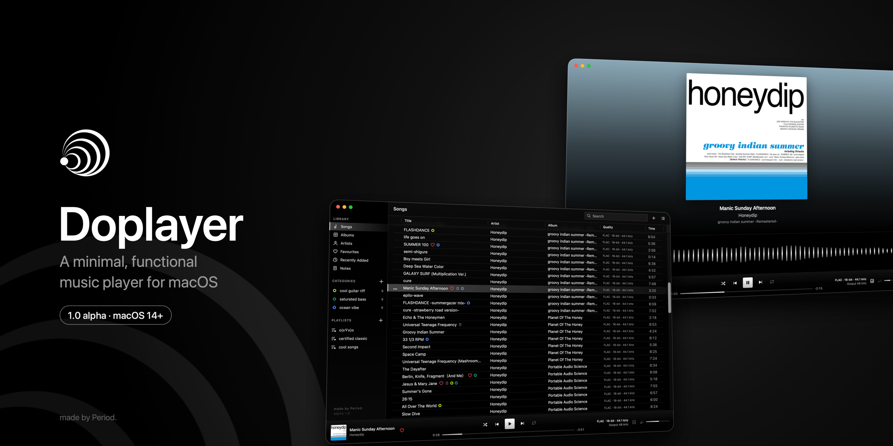
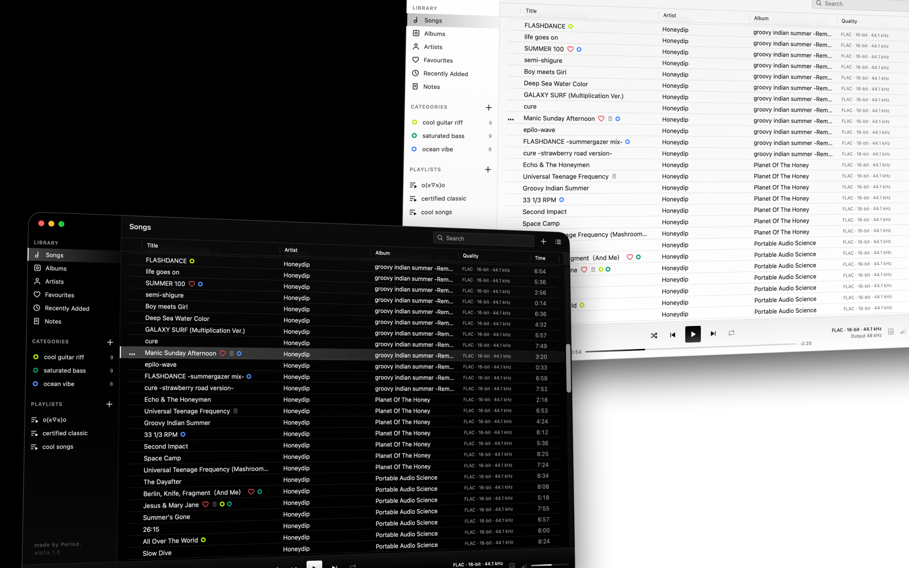
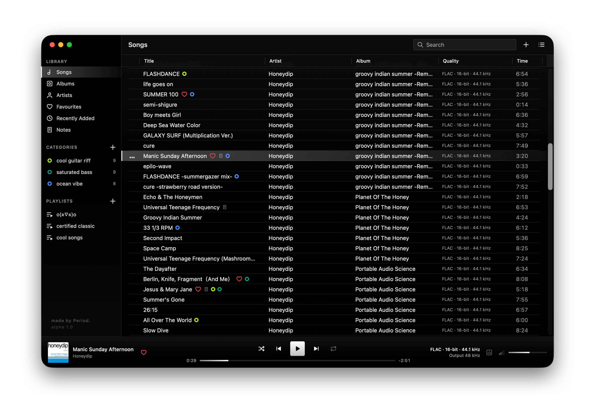
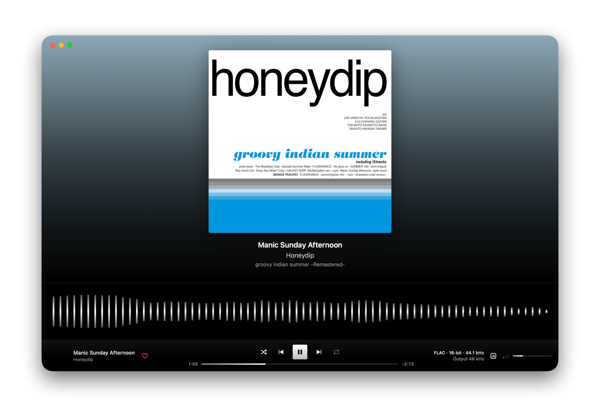

# Doplayer

A native, minimalist audio player for macOS with bit-perfect output.

> **Alpha 1.0.** This is the first public alpha. It is signed only ad hoc (no Apple Developer ID) and is not notarised, so macOS will ask you to confirm the first launch — see below. made by Period.

## Screenshots

*Dark and light themes*

## Features

- **Formats:** FLAC, WAV, AIFF, ALAC and AAC (tested). Other formats provided by [SFBAudioEngine](https://github.com/sbooth/SFBAudioEngine) — MP3, Opus, Ogg Vorbis, WavPack, Monkey's Audio (APE), TTA, Musepack, DSD (DSF/DFF) — should play but are untested.
- **Bit-perfect output:** the output device's sample rate can follow each file (optional), an honest "Bit-perfect" indicator in the player bar, and gapless playback for consecutive tracks with the same format. Exclusive (hog) mode is available but only lightly tested.
- **Library:** music folders, tags and covers; Songs, Albums, Artists, Favourites, Recently Added; search with suggestions; drag folders into the window.
- **Playlists and categories:** your own playlists and coloured categories for tagging tracks; drag tracks onto them.
- **Notes:** short notes on tracks and albums, with a Notes tab to browse them.
- **Visualizer:** a minimal mirrored spectrum under the track list.
- **Look:** dark and light theme, black-and-white interface, optional greyscale covers.
- **Languages:** Russian and English.
- **Keyboard and media keys:** Space play/pause, ⌘←/⌘→ tracks, ⌘↑/⌘↓ volume, ⌘L favourite, media keys and Control Centre.

## Requirements

- macOS 14 Sonoma or later
- Apple silicon or Intel (universal binary)

## Install

1. Download `Doplayer-1.0-alpha.dmg` from the Releases page.
2. Open it and drag **Doplayer** onto **Applications**.
3. Eject the disk image.

### First launch (the app is not notarised)

- **macOS 15 and later:** open Doplayer once; macOS will say it cannot verify the developer. Click **Done**, then open **System Settings → Privacy & Security**, scroll down and click **Open Anyway** next to Doplayer, and confirm.
- **macOS 14:** in Applications, right-click (or Control-click) Doplayer, choose **Open**, then **Open** again.

After that it opens normally. Then click **+** at the top of the window, or drag a music folder into it.

## Source code

Source code is not published yet.

## Licence notes

Doplayer uses open-source libraries; see `THIRD_PARTY_NOTICES.md`.

---

**Doplayer** — минималистичный аудиоплеер для macOS с воспроизведением без изменений сигнала (bit-perfect). Это первая альфа-версия (1.0).

**Установка:** откройте `Doplayer-1.0-alpha.dmg` и перетащите Doplayer в «Программы».

**Первый запуск** (приложение не нотаризовано Apple):
- macOS 15 и новее: откройте Doplayer, нажмите «Готово», затем «Системные настройки → Конфиденциальность и безопасность» → «Всё равно открыть» рядом с Doplayer.
- macOS 14: правый щелчок по Doplayer в «Программах» → «Открыть» → «Открыть».

Требуется macOS 14 или новее, Apple silicon или Intel. made by Period.
